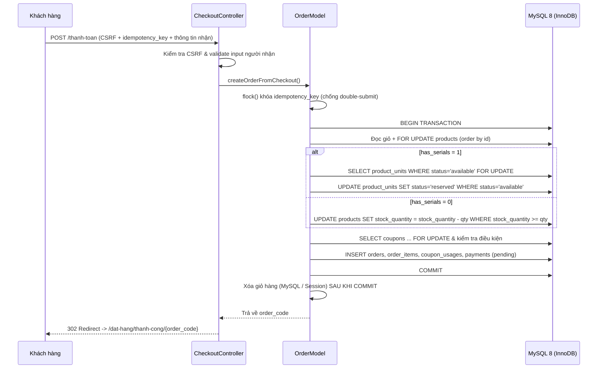

# Quy Trình Thanh Toán (Checkout) & Tạo Đơn Hàng — TL Gaming

## 1. Tổng quan & Đường dẫn (Routes)
Phân hệ Checkout phía khách hàng được điều phối bởi `App\Controllers\CheckoutController` và xử lý nghiệp vụ nguyên tử tại `App\Models\OrderModel`, `App\Models\CouponModel`:
- `GET /thanh-toan`: Hiển thị trang thanh toán 2 cột theo thiết kế Google Stitch (`app/Views/checkout/index.php`), từ chối mở nếu giỏ hàng trống.
- `POST /thanh-toan/xem-truoc` *(CSRF)*: API nội bộ tính lại Tạm tính, Giảm giá Voucher, Phí vận chuyển và Tổng thanh toán hoàn toàn trên Server.
- `POST /thanh-toan` *(CSRF)*: Xác nhận đặt hàng trong MySQL Transaction.
- `GET /dat-hang/thanh-cong/{order_code}`: Hiển thị kết quả đơn hàng (kiểm soát quyền sở hữu theo `user_id` hoặc token phiên vừa đặt, chống IDOR).
- `GET /tra-cuu-don-hang` & `POST /tra-cuu-don-hang` *(CSRF)*: Tra cứu đơn hàng bảo mật bằng `order_code` kết hợp xác minh số điện thoại hoặc email đặt hàng (không đưa SĐT/email lên URL).

## 2. Các bảng dữ liệu sử dụng
- `carts`, `cart_items`: Đọc giỏ hàng hiện tại của thành viên đã đăng nhập (kèm gộp `pending_guest_cart` trong Session nếu có).
- `products`, `categories`: Kiểm tra trạng thái `published`, danh mục hoạt động (`is_active = 1`), đọc đơn giá thực tế và trừ `stock_quantity` đối với sản phẩm `has_serials = 0`.
- `product_units`, `product_inspections`: Khóa và phân bổ từng máy vật lý `status = 'available'` (biên bản kiểm định **mới nhất** không phải `failed`), chuyển sang `reserved` khi `has_serials = 1`.
- `coupons`, `coupon_usages`: Kiểm tra hiệu lực voucher và ghi nhận lượt sử dụng.
- `orders`, `order_items`, `payments`: Lưu đơn hàng, snapshot sản phẩm + số serial được gán, và bản ghi thanh toán (`status = 'pending'`, hỗ trợ cả đơn `0đ`).
- `checkout_idempotency`: Lưu trữ khóa chống đặt trùng bền vững trong MySQL gắn với `actor_hash` và `payload_hash`.

## 3. Sequence Flow tạo đơn hàng

## 4. Cách tính tiền & Cấu hình vận chuyển Demo
- Mọi tính toán thực hiện 100% trên Server bằng số nguyên VND (`int`):
  - `total_product_amount` = Tổng `products.price * quantity`.
  - `shipping_fee`: Đọc từ `config/checkout.php` (**cấu hình demo tập trung** do schema hiện tại chưa có bảng biểu phí vận chuyển riêng):
    - Nhận tại showroom (`pickup`): `0 ₫`.
    - Giao tận nơi (`delivery`): `0 ₫` nếu `total_product_amount >= 10.000.000 ₫`; `30.000 ₫` nội thành Hà Nội/TP.HCM; `50.000 ₫` các tỉnh/thành khác.
  - `discount_amount`: Tính từ `coupons` (`percentage` có `max_discount_amount`, hoặc `fixed_amount`), luôn bị chặn `<= total_product_amount`.
  - `final_amount = total_product_amount + shipping_fee - discount_amount` (`>= 0`).
- Nếu giá sản phẩm hoặc tổng tiền thay đổi giữa lúc mở trang Checkout và lúc bấm Xác nhận (`expected_subtotal` / `expected_final_amount` lệch với Server), Transaction rollback và yêu cầu khách kiểm tra lại tổng tiền.

## 5. Quy tắc Serial & Tồn kho
- `has_serials = 1`: Nguồn chân lý là `product_units.status`. Khóa `N` máy `available` bằng `SELECT ... FOR UPDATE`, cập nhật có điều kiện `status = 'reserved'` (`rowCount() === 1`), tách thành `N` dòng `order_items` (`quantity = 1`, gắn `product_unit_id` và `unit_serial_number`), đồng thời cập nhật cache `products.stock_quantity` bằng đúng số máy `available` còn lại.
- `has_serials = 0`: Nguồn chân lý là `products.stock_quantity`, trừ kho bằng `UPDATE ... WHERE stock_quantity >= :qty` (`rowCount() === 1`).

## 6. Voucher, COD & Chuyển khoản
- Voucher khóa bằng `SELECT ... FOR UPDATE` trên `coupons`, kiểm tra `is_active`, `start_date..end_date`, `min_order_amount`, `usage_limit`, và `per_user_limit` (qua `user_id` nếu đăng nhập, hoặc `customer_email`/`customer_phone` nếu khách vãng lai).
- `COD` (`payment_method = 'cod'`) và `Chuyển khoản` (`payment_method = 'bank_transfer'`) đều tạo bản ghi `payments` với `status = 'pending'` (hỗ trợ cả đơn `0đ` khi voucher giảm 100% tiền hàng và phí ship = `0đ`). Thông tin ngân hàng và showroom chỉ hiển thị/cho phép chọn nếu được cấu hình qua biến môi trường `.env` (`TL_BANK_*`, `TL_SHOWROOM_*`), không tự bịa số tài khoản hay địa chỉ giả.

## 7. Xử lý lỗi, Rollback, Idempotency & Dọn giỏ
- Phân tách ngoại lệ nghiệp vụ (`App\Core\CheckoutException`) với lỗi kỹ thuật/SQL (`Throwable`): lỗi nghiệp vụ hiển thị thông báo rõ ràng; lỗi kỹ thuật chỉ ghi log nội bộ và trả thông báo chung an toàn.
- Mọi lỗi đều gọi `rollBack()` toàn bộ Transaction; giỏ hàng của khách không bị xóa.
- Chống double-submit bền vững: Server cấp `idempotency_key` gắn `actor_hash`, khóa đồng thời bằng `flock(LOCK_EX)` (thất bại là dừng an toàn) và lưu trạng thái `completed` cùng `payload_hash` vào bảng `checkout_idempotency` trong MySQL. Mọi nhánh retry đều kiểm tra thống nhất `actor_hash` và `payload_hash`, từ chối token giả mạo/sai tác nhân/khác payload, và **không** dọn giỏ mới của người dùng khi retry.
- Dọn giỏ sau `commit()`: Chỉ trừ đúng số lượng từng sản phẩm đã commit vào đơn (hỗ trợ cả Session của guest và MySQL `cart_items` + `pending_guest_cart` của customer), bảo toàn sản phẩm mới thêm hoặc số lượng tăng thêm đồng thời.
- Tra cứu đơn hàng (`POST /tra-cuu-don-hang`) được bảo vệ bởi `RateLimiter` theo IP và Session (chặn sau 5 lần sai).
